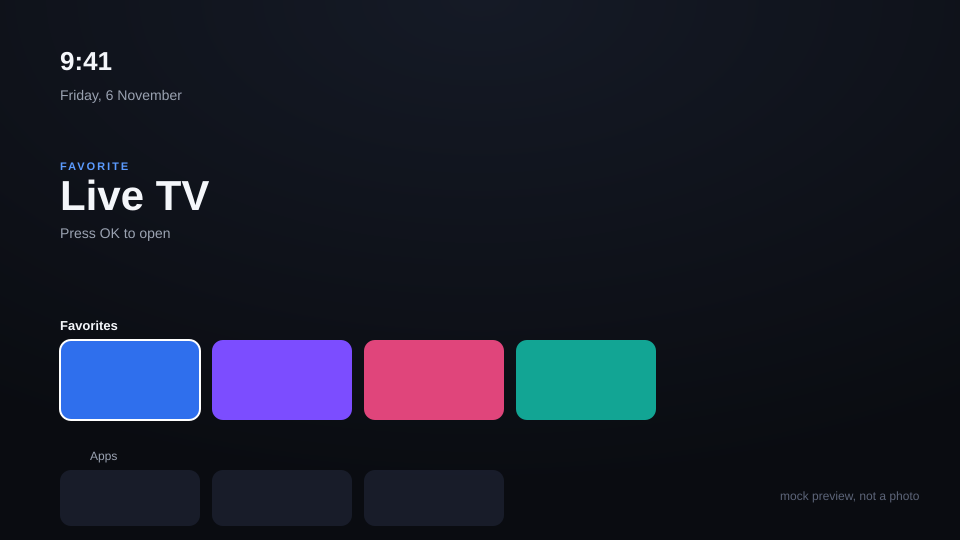

# webos-tv-home

A clean, fast replacement home screen for rooted LG webOS TVs — plus a
community app store and a debloat kit — built for TVs with little RAM and an
old browser engine, where most "smart TV customization" guides don't apply.

**Status: rebuilt from scratch, not yet verified on real hardware.** The
original build of this ran on an LG 49UK7500PTA for several weeks; that TV
later developed an unrelated hardware panel fault and was factory reset,
and the source was lost with it. This repo is a clean rewrite, checked for
correct ES5 syntax and previewed in a desktop browser against a mock
backend, but **not yet re-tested on a physical TV.** Open an issue if
something doesn't work on yours.



## What's in here

| Path | What it is |
|---|---|
| `apps/home` | The launcher: rows of your installed apps, a focused hero area, Favorites/Apps/Inputs grouping. Replaces what you see when you press Home. |
| `apps/store` | A store for the open-source [webOS Homebrew](https://www.webosbrew.org/) app catalogue — install and remove community apps without touching LG's Content Store. |
| `debloat/` | Scripts to remove non-essential preinstalled apps and report RAM/storage before and after. |
| `autostart/` | The boot scripts and Home-key watcher that make the launcher open automatically and respond to the remote's Home button. |
| `scripts/` | Build, install, uninstall, and a rooting-compatibility checker. |
| `docs/` | Install guide, architecture notes, troubleshooting, rooting pointers. |

## Requirements

- A **rooted** LG webOS TV (webOS 4.x+) with the
  [Homebrew Channel](https://www.webosbrew.org/) installed. This repo
  doesn't root your TV — see [docs/ROOTING.md](docs/ROOTING.md) for the
  actual (community-maintained) tool to do that, and a compatibility
  checker script.
- A PC with [Node.js](https://nodejs.org/) and the webOS CLI
  (`npm i -g @webosose/ares-cli`).

## Quick start

```sh
git clone https://github.com/<you>/webos-tv-home.git
cd webos-tv-home
./scripts/check-compat.sh <your TV model> <firmware>   # optional sanity check
./scripts/install.sh <ares-device-name>
```

Full steps, including registering the TV with `ares-setup-device`, are in
[docs/INSTALL.md](docs/INSTALL.md).

## Debloating (no launcher install required)

The debloat scripts work standalone — you can use them on a rooted TV even
if you don't want this launcher:

```sh
./debloat/tv-stats.sh <ares-device-name>             # see current RAM/storage
./debloat/debloat.sh <ares-device-name> --dry-run     # preview what would go
./debloat/debloat.sh <ares-device-name>               # remove it
```

Edit `debloat/apps-removable.txt` to control the list. Core system apps are
never touched.

## Previewing without a TV

Both apps run in a desktop browser against a mock webOS backend (see
`js/platform.js` in each), which is what the build above renders. Useful
for UI changes without round-tripping to real hardware:

```sh
cd apps/home && python3 -m http.server 8080   # then open localhost:8080
```

## Why not just use LG's own home screen?

You can — this is for people who find it slow, ad-heavy, or want an app
list that isn't curated by LG. It doesn't replace LG's launcher (that's
baked into the system and can't be removed); it redirects the remote's Home
key to this one instead. See [docs/ARCHITECTURE.md](docs/ARCHITECTURE.md).

## Limitations, on purpose

- No Netflix/Prime Video/other DRM-licensed streaming apps in the store —
  those are tied to LG's own app signing and aren't something a
  third-party store can distribute. Use LG's Content Store for those.
- No deep-linking into LG's own paid or DRM content from this launcher.
- Nothing here attempts to root a TV or bypass any security mechanism —
  rooting goes through the existing, actively maintained community tool
  (linked in docs/ROOTING.md), which this repo treats as a prerequisite,
  not something to reimplement.

## Picking this up later (human or AI)

See [AGENT_HANDOFF.md](AGENT_HANDOFF.md) for current state, what's verified
vs. not, and what's deliberately out of scope.

## Contributing

Issues and PRs welcome, especially hardware reports (model + firmware +
what worked/didn't) since this hasn't been re-verified on a TV yet. Keep
new code ES5 and avoid anything requiring more than ~50MB of extra RAM —
see [docs/ARCHITECTURE.md](docs/ARCHITECTURE.md) for the constraints this
was built against.

## License

MIT — see [LICENSE](LICENSE).
